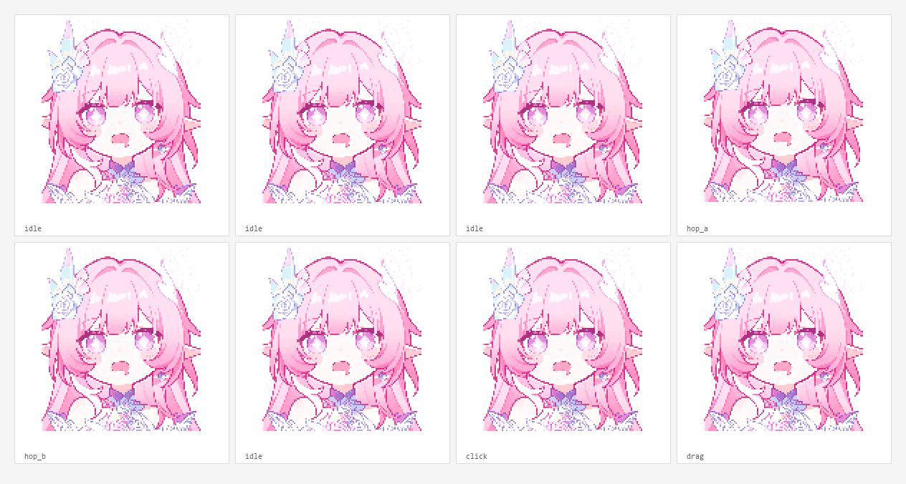

# MintPet

一个 Windows 桌面宠物，同时是一个 **DeepSeek 余额悬浮窗**。

粉发精灵像素形象、透明置顶、点击互动、余额数字逐格跳动，余额变化时胶囊和桌宠一起抖动。没有安装器，不依赖额外运行库，Windows 10/11 自带 .NET Framework 4.x 即可运行。


## 功能

- **128×128 透明像素桌宠**：粉色长发、精灵耳、花朵发饰、白紫服装
- **静止待机**：平时不动，只有点击时才小跳并播放“啵”的点击音
- **余额悬浮胶囊**：显示 DeepSeek 余额，可设置 1 / 2 / 5 / 10 / 30 分钟刷新
- **逐格跳动**：余额变化时数字一格格跳到新值，每跳一格胶囊和桌宠都会抖一下
- **扣费安静模式**：余额减少时不弹“消耗了多少”的气泡，只保留数字、抖动和音效
- **音效独立设置**：
  - 余额变动音效：关闭 / 经典受伤 / 金币 / 8-bit / 重拳 / 激光 / 气泡 / 啵
  - 余额音量：小 40% / 中 70% / 大 100%
  - 点击音效：独立开关
  - 点击音量：小 40% / 中 70% / 大 100%
- **设置保存在 exe 同目录**，不写 AppData；API Key 用 Windows DPAPI 加密
- **开机自启**：任务计划启动，可右键“修复开机自启（管理员）”
- 无 telemetry，无后台网络请求，除余额查询外不联网



## 构建

要求：

- Windows 10 / 11
- .NET Framework 4.x（系统自带）
- PowerShell
- 不需要 Visual Studio、.NET SDK 或 NuGet

在仓库根目录执行：

```powershell
powershell -NoProfile -ExecutionPolicy Bypass -File .\build.ps1
```

产物：

```text
dist/
├─ MintPet.exe
└─ assets/
   ├─ pet.gif
   └─ click.gif
```

`dist/` 是构建产物，不提交到 Git。

## 使用

1. 构建后双击 `dist\MintPet.exe`
2. 右键桌宠打开菜单
3. `设置 API Key…` 填入 DeepSeek API Key
4. 需要余额显示时，保持 `显示余额` 勾选
5. 需要开机启动时，勾选 `开机自启`；如果开机仍弹“未知发布者”，点 `修复开机自启（管理员）` 并批准 UAC

余额查询使用 DeepSeek 官方 API：

```text
https://api.deepseek.com
```

## 设置与隐私

- 设置文件：`MintPet.exe` 同目录的 `settings.ini`
- API Key 使用 **Windows DPAPI（当前用户）** 加密后写入，换电脑/换用户无法解密，需要重新填写
- `settings.ini` 已被 `.gitignore` 排除；**不要把包含 API Key 的设置文件提交到 GitHub**
- 程序不收集遥测，不写注册表之外的隐私数据
- 余额查询失败时只显示脱敏后的错误文本

## 开机自启与 SmartScreen

这个 exe 没有购买代码签名证书，Windows 可能显示“未知发布者”提示。

- 右键 → `修复开机自启（管理员）`：用管理员权限创建任务计划并删除旧的 Run 键
- 任务计划启动通常不会再走 Explorer 的发布者检查
- 如果公司电脑有 AppLocker / WDAC / 组策略限制，任务计划也可能被拦截

## 目录结构

```text
MintPet/
├─ src/                 # C# WinForms 源码
├─ assets/              # pet.gif / click.gif
├─ docs/                # 截图与预览
├─ build.ps1            # 用系统自带 csc 编译
├─ app.manifest         # DPI / Windows 10-11 兼容
├─ LICENSE              # 代码 MIT
└─ NOTICE.md            # 角色与第三方声明
```

## 已知限制

- 仅支持 Windows（WinForms + .NET Framework）
- exe 未签名，首次运行可能触发 SmartScreen
- 任务计划创建需要当前用户有相应权限
- 角色立绘是二创像素画，不是官方素材；公开或商用前请确认角色原型的授权

## License

- **代码**：MIT，见 [LICENSE](LICENSE)
- **角色立绘 / 像素素材**：见 [NOTICE.md](NOTICE.md)，基于提供的参考图制作，非官方，默认仅用于个人展示，不随代码 MIT 授权用于商业用途
- DeepSeek 是其权利人的商标；本项目与 DeepSeek 官方无隶属关系
